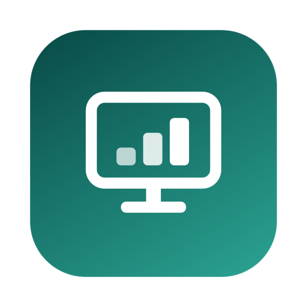

<p align="center">
  
</p>

<h1 align="center">ScaleBar</h1>

<p align="center">
  <b>Make your external monitor look sharp on a Mac.</b><br>
  HiDPI scaling at the size you want, plus brightness and volume control, all from the menu bar.
</p>

<p align="center">
  <a href="../../releases/latest"><b>Download</b></a> ·
  <a href="#features">Features</a> ·
  <a href="#install">Install</a> ·
  <a href="#faq">FAQ</a>
</p>

<p align="center">
  <a href="https://github.com/javedh-dev/ScaleBar/releases/latest"></a>
  <a href="https://github.com/javedh-dev/ScaleBar/releases"></a>
  
  
  
  
</p>

---

## Why

Plug a 1440p monitor into a Mac and you get two choices: text that's too small, or text that's blurry. macOS only renders HiDPI (Retina-quality) on these monitors at exactly 2x, which makes everything huge. Every size in between, like "looks like 2048×1152", gets stretched and looks soft.

ScaleBar gives you proper HiDPI at the in-between sizes too: 1.25x, 1.5x and 1.75x. Text stays crisp, and you pick how big things look with one slider.

## Features

- **One scale slider per display.** 1x to 3x in 0.25 steps. It uses the monitor's own modes when they exist, and a virtual HiDPI display for the sizes macOS won't give you.
- **Brightness and volume** for external monitors over DDC/CI, in the same 16 steps as the built-in keys.
- **Your keyboard keys work again.** With the lid closed, the brightness keys control the monitor. When sound goes to the monitor, so do the volume keys. You get the familiar on-screen popup.
- **Remembers each monitor.** Unplug, plug back in, and your scale comes back. A quick cable wiggle doesn't make the screen flash over and over.
- **Tells you when something won't work.** If your Mac, port or monitor can't do something, the menu and Settings say why, instead of just doing nothing.
- **Small and native.** One Swift file, no Electron, no dependencies, no account, no tracking.

## Install

### Homebrew

```sh
brew install --cask javedh-dev/tap/scalebar
```

Updates come with `brew upgrade`, and macOS won't show the first-launch warning. For the brightness and volume keys, allow Accessibility as in step 4 below.

### Download

1. Download the latest **ScaleBar-x.y.z.zip** from [Releases](../../releases/latest).
2. Unzip it and drag **ScaleBar.app** into **Applications**.
3. The first time you open it, right-click the app and choose **Open**. It's free and not notarized by Apple, so macOS asks once.
4. Want the brightness and volume keys? Allow ScaleBar in **System Settings → Privacy & Security → Accessibility**. Settings has a button that takes you there.

ScaleBar checks GitHub once a day for a new version and lets you know. It never downloads or installs anything on its own, and you can turn the check off.

## What works where

|                                   | Needs                                                          |
| --------------------------------- | -------------------------------------------------------------- |
| Scale slider                      | macOS 14 or later                                              |
| In-between sizes (1.25x, 1.5x, …) | macOS 14 or later                                              |
| Brightness and volume             | Apple Silicon Mac, with DDC/CI turned on in the monitor's menu |
| Keyboard keys                     | Accessibility permission, plus brightness and volume working   |

Brightness and volume work over USB-C and DisplayPort on most monitors. Some docks, adapters and the built-in HDMI port on certain Macs don't pass the signal through. ScaleBar will tell you if that's the case.

## FAQ

**Why does my external monitor look blurry on my Mac?**
Usually you've picked a "scaled" size like 2048×1152 on a 1440p monitor. macOS draws it at that size and stretches it to fit the panel. Pick the same size in ScaleBar (1.25x) and it's rendered as HiDPI instead, so it stays crisp.

**How do I turn on HiDPI for a 1440p or 1080p monitor on an M1, M2, M3 or M4 Mac?**
On Apple Silicon, macOS ignores the old display-override trick. ScaleBar creates a virtual HiDPI display at the size you choose and mirrors your monitor from it. You don't need to set anything up; just move the slider.

**Is 1.5x as sharp as 1x or 2x?**
1x and 2x map pixels exactly. In-between sizes are drawn at double resolution and scaled down, which looks much better than macOS's normal scaling, but it isn't quite pixel-perfect.

**Why can't I get 100Hz or 144Hz?**
ScaleBar uses the highest refresh rate your monitor offers at full resolution. If macOS doesn't list it, the cable is usually the reason. USB-C cables that also carry USB data often have only enough bandwidth for 60–75Hz at 1440p. Try a USB-C to DisplayPort cable, or the monitor's "USB-C priority: high resolution" option.

**What happens if ScaleBar crashes?**
macOS removes the virtual display and your monitor goes straight back to normal. Display changes also only last until you log out. If something ever looks stuck, run `killall ScaleBar`.

**Does it read my keyboard?**
It only reacts to the brightness and volume keys. Every other key goes straight through and is never stored or logged.

**How is this different from BetterDisplay or MonitorControl?**
They're great, and do much more. ScaleBar does fewer things: a scale slider plus brightness and volume, in a small, free, open-source app.

## Build it yourself

```sh
git clone https://github.com/javedh-dev/ScaleBar.git && cd ScaleBar
Scripts/make-cert.sh   # once: a local signing certificate, so macOS remembers the Accessibility permission
Scripts/build.sh       # builds build/ScaleBar.app and runs a quick self-test
open build/ScaleBar.app
```

You only need Xcode or the Command Line Tools.

```
Sources/ScaleBar/
  App/        main.swift (entry point, self-test), App.swift (startup, shared state),
              Updates.swift (GitHub update check), Support.swift (small helpers)
  Display/    VirtualDisplay.swift (virtual HiDPI display and mirroring)
  Monitor/    DDC.swift (brightness and volume over DDC/CI), Keys.swift (keyboard keys, on-screen popup)
  UI/         Menu.swift (menu and scale slider), Settings.swift (Settings, About), Icon.swift (icons, drawn in code)
  ScaleBar-Bridging-Header.h   macOS APIs Apple doesn't publish
Resources/    Info.plist
Scripts/      build.sh, make-cert.sh
.github/      workflows (CI, Release), assets (README images)
.version      current version
```

## Releasing

Releases are built by GitHub Actions. `.version` holds the current version.

- Every push and pull request is built and tested by **CI**.
- To ship a version, open **Actions → Release → Run workflow** and pick `patch`, `minor` or `major` (or `none` to ship `.version` as it is). The workflow builds and tests the app. If that passes, it bumps `.version`, tags the commit and publishes the release with the zip and its checksum.
- Optional but recommended: run `Scripts/make-cert.sh --ci` once and add the two secrets it prints. Every release is then signed with the same certificate, so users don't have to grant Accessibility again after each update.

## How it was made

The code was written with [Claude](https://claude.ai), Anthropic's AI assistant. Humans designed the app, steered every change, and tested it on real monitors.

## Thanks

ScaleBar learned a lot from [BetterDisplay](https://github.com/waydabber/BetterDisplay), [MonitorControl](https://github.com/MonitorControl/MonitorControl), [m1ddc](https://github.com/waydabber/m1ddc) and [DeskPad](https://github.com/Stengo/DeskPad).

## License

MIT © Javed Hussain
